# Plan de Blindaje y Corrección de Vulnerabilidades: `errors_plan.md`

> **Objetivo**: Subsanar de forma metódica y rigurosa todas las vulnerabilidades críticas, inconsistencias de concurrencia, riesgos de deadlock y brechas de permisos identificadas en la auditoría de seguridad integral, validando cada fase con pruebas automatizadas (TDD) y registrando flags de control en Git.

---

## Diagrama de Flujo y Arquitectura de Blindaje

```mermaid
graph TD
    subgraph "Fase 1: Precisión Decimal e Inventario"
        A1[StockIncome / Outcome Truncation] -->|Fix float & round 3 dec| B1[Stock Exacto DECIMAL 12,3]
        A2[SupplierOrderItem integer] -->|FlexibleDecimal & Numeric| B2[Compras Fraccionadas sin Pérdida]
    end

    subgraph "Fase 2: Control de Acceso & Permisos"
        C1[Route::resource categories] -->|Desglose granular| D1[ver, crear, editar, eliminar aislados]
        C2[StoreUserRequest role exists] -->|Rule::notIn admin| D2[Prevención Escalabilidad de Privilegios]
    end

    subgraph "Fase 3: Concurrencia & Secuencias Atómicas"
        E1[Arbitrary Product lockForUpdate] -->|orderBy ID asc| F1[Cero Deadlocks en Compras Concurrentes]
        E2[max ID para order_number] -->|TenantSequence lockForUpdate| F2[Secuencias Atómicas Correlativas por Tenant]
    end

    subgraph "Fase 4: Hardening & Auditoría Inmutable"
        G1[ProductController stock update] -->|Read-only en Formulario| H1[Kardex 100% Inmutable y Confiable]
        G2[User.php Fillable] -->|Remover is_superadmin/tenant_id| H2[Protección Mass Assignment Estricta]
        G3[Fortify registration] -->|Deshabilitar ruta pública| H3[Cero Cuentas Huérfanas]
    end
```

---

## Desglose de Fases de Corrección

### 🔴 Fase 1: Precisión Decimal y Operaciones de Stock (Crítica)
- **Archivos a modificar**:
  - `app/Http/Controllers/Tenant/Stock/StockIncomeController.php`: Reemplazar `(int)` por `(float)` y `round($v, 3)` en `$quantity`, `$previousStock`, `$currentStock`.
  - `app/Http/Controllers/Tenant/Stock/StockOutcomeController.php`: Reemplazar `(int)` por `(float)` y `round($v, 3)`.
  - `app/Models/SupplierOrderItem.php`: Cambiar `'quantity' => 'integer'` por `FlexibleDecimal::class`.
  - `app/Http/Requests/Tenant/StoreSupplierOrderRequest.php`: Validar `'items.*.quantity' => ['required', 'numeric', 'min:0.001']`.
  - `app/Http/Controllers/Tenant/SupplierOrderController.php`: Manejar float y round al recepcionar mercadería.
- **Testing (Pest)**: `tests/Feature/Tenant/StockFractionalOperationsTest.php`.
- **Git Flag**: `fix(fase-1): precision decimal en ingresos egresos y recepcion de ordenes de compra`.

---

### 🔴 Fase 2: Blindaje de Permisos en Categorías & Restricción de Roles en API (Alta)
- **Archivos a modificar**:
  - `routes/tenant.php`: Desglosar `Route::resource('categories', ...)` asignando middlewares individuales:
    - `GET categories` $\rightarrow$ `tenant.permission:productos.ver`
    - `POST categories` $\rightarrow$ `tenant.permission:productos.crear`
    - `PUT/PATCH categories/{category}` $\rightarrow$ `tenant.permission:productos.editar`
    - `DELETE categories/{category}` $\rightarrow$ `tenant.permission:productos.eliminar`
  - `app/Http/Requests/Tenant/StoreUserRequest.php` & `UpdateUserRequest.php`:
    - Agregar `Rule::notIn(['admin', 'superadmin', 'Administrador', 'Superadmin'])` en el campo `role`.
  - `app/Http/Controllers/Tenant/CategoryController.php`:
    - Validar en `destroy()` que si la categoría posee productos asociados (`$category->products()->exists()`), devuelva un error HTTP 422 descriptivo para no dejar productos incompletos ni bloquear ventas.
- **Testing (Pest)**: `tests/Feature/Tenant/TenantPermissionsAndRoleBypassTest.php`.
- **Git Flag**: `fix(fase-2): blindar permisos granulares en categorias y restringir asignacion de rol admin en api`.

---

### 🟡 Fase 3: Secuencias Atómicas por Tenant para `order_number` & Prevención de Deadlocks (Media)
- **Archivos a modificar**:
  - Crear migración `create_tenant_sequences_table`:
    - Campos: `id`, `tenant_id`, `sequence_type` (ej. `'customer_order'`, `'supplier_order'`), `current_number` (bigint unsigned default 0), timestamps.
    - Índice único compuesto: `unique(['tenant_id', 'sequence_type'])`.
  - Migración para agregar índice único en pedidos:
    - `unique(['tenant_id', 'order_number'])` en `customer_orders` y `supplier_orders`.
  - Crear servicio `App\Services\TenantSequenceService`:
    - Método `nextNumber(int $tenantId, string $type, string $prefix): string` ejecutando `lockForUpdate()` atómico sobre la fila del tenant y formateando correlativo (ej. `PED-00001`).
  - `app/Http/Controllers/Tenant/CustomerOrderController.php`:
    - Usar `TenantSequenceService` para asignar el número de orden.
    - Ordenar los IDs de productos ascendentemente (`orderBy('id')->lockForUpdate()`) antes de adquirir bloqueos pesimistas para eliminar riesgo de deadlock en compras concurrentes.
  - `app/Http/Controllers/Tenant/SupplierOrderController.php`:
    - Usar `TenantSequenceService` para asignar número de orden de compra.
- **Testing (Pest)**: `tests/Feature/Tenant/TenantAtomicSequenceTest.php`.
- **Git Flag**: `fix(fase-3): secuencias atomicas por tenant para pedidos y ordenamiento determinista contra deadlocks`.

---

### 🟢 Fase 4: Hardening de Kardex, Modelo `User` y Cierre de Registro Público (Baja)
- **Archivos a modificar**:
  - `app/Http/Controllers/Tenant/ProductController.php`: Desvincular `'stock'` de `update()` para que el inventario solo se altere mediante transacciones auditadas en Kardex o Pedidos.
  - `app/Models/User.php`: Remover `is_superadmin` y `tenant_id` de `#[Fillable]`.
  - `config/fortify.php`: Deshabilitar `Features::registration()`.
- **Testing (Pest)**: `tests/Feature/Tenant/SecurityHardeningTest.php`.
- **Git Flag**: `fix(fase-4): inmutabilidad de stock en edicion user fillable hardening y cierre de registro publico`.

---

### 🛡️ Fase 5: Verificación Integral de Seguridad, E2E y Calidad de Código
- **Verificaciones**:
  - Ejecución de suite completa de Pest: `php artisan test --compact` (100% en verde).
  - Ejecución de suite E2E de Playwright: `pnpm exec playwright test` (100% en verde).
  - Formateo de código estricto con Pint: `vendor/bin/pint --format agent`.
- **Git Flag**: `fix(fase-5): verificacion integral y blindaje de seguridad completado`.
